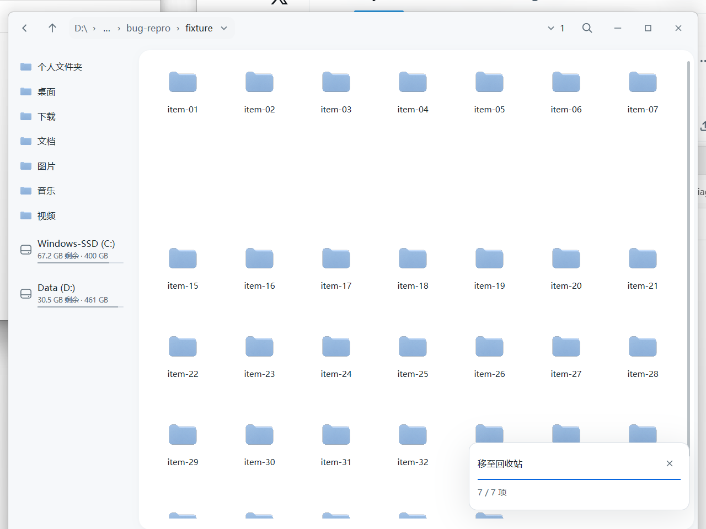
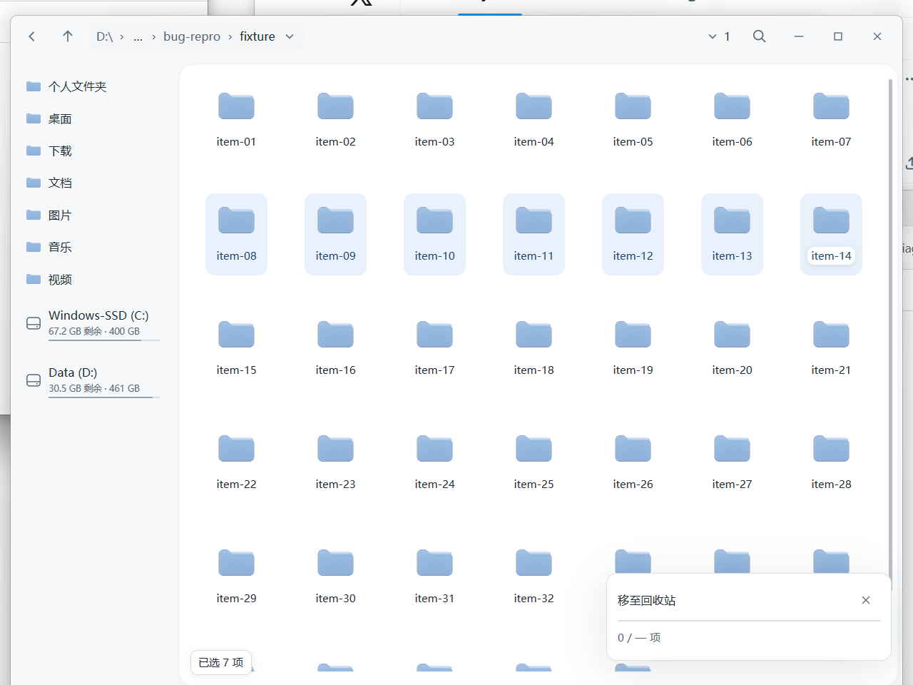

# preview.28 · 拖放与删除刷新修复

日期：2026-11-06（Asia/Shanghai）
源码：`6fd140e82a20f2f978bd58ac4d132af084d2e93e`（修复）、`3c45e9570fa6f2d4b64290a8792c040fb1282ff5`（preview.28 版本与说明）
候选版本：`0.1.0-preview.28`

## 修复内容

1. **删除后整行空白**：应用内删除/移动/重命名等操作完成后不再等待 450ms 监听防抖，下一帧即重建目录快照；快照提交前，已移除项目不再渲染为空白单元格，而是保留淡化占位，避免整行看起来消失。
2. **刷新期间拖放被误判为不可放置**：外部 OLE 拖放目标不再因为目录快照尚未提交（`watch_stale`）而把目标位置设为 `None`；拖入期间仍按指针位置解析目标，并在执行前按捕获的目录身份校验。删除文件后立即再次从 Explorer 拖入不会再显示“不能放到此位置”。

相关代码：`src/app_watch.rs`、`src/app_operations.rs`、`src/app_ole.rs`、`src/main.rs`；完整 diff 见 [fix-commit.diff](fix-commit.diff)。

## 空白行的可见对比

同一台机器、同一操作序列：打开含 40 个目录的 fixture，选中第二行 `item-08`，按 Shift+Right 扩展 7 项，Delete 移入回收站，约 120ms 后截取桌面并裁剪到 Backleaf 窗口区域（1280×960）。

| preview.27（修复前） | preview.28（修复后） |
| --- | --- |
|  |  |
| 第二行 7 项立即变空白，只剩上下两行，形成“一大块空白”。 | 已移除行保留淡化占位，不再出现空白行；快照提交后正常消失。 |

第三张 [blank-row-published-preview28.png](screenshots/blank-row-published-preview28.png) 来自匿名下载并解压后的**已发布 CI 可执行文件**，确认发布产物同样保留占位而非空白行。对应的网格 UIA 记录：[preview.27](blank-row-preview27-report.json)、[本地修复构建](blank-row-preview28-report.json)、[已发布产物](blank-row-published-report.json)。

## 已发布包

- Release：[test-v0.1.0-preview.28-3c45e957](https://github.com/simiooo/backleaf/releases/tag/test-v0.1.0-preview.28-3c45e957)，发布 2026-11-06 13:51:59 +08:00（05:51:59Z），pre-release，非 draft，tag 目标 `3c45e95`。
- [Windows 测试包 CI 42170128639](https://github.com/simiooo/backleaf/actions/runs/42170128639)（fmt/严格 Clippy/112 项逻辑-文件-原生测试/40 项无头交互/安装回归/打包）与 [headless CI 42170125562](https://github.com/simiooo/backleaf/actions/runs/42170125562) 均为 success；原始结论见 [ci-package-status.json](ci-package-status.json)、[ci-headless-status.json](ci-headless-status.json)。
- 资产：ZIP `ffac29ab…4bfd14`（16,480,132 字节）、设计 `216c6ffd…5ab179`、构建记录 `abe9b478…7f128f`、摘要文件 `411dc45a…270fb`。
- ZIP、build.json、SHA256SUMS.txt 均通过 HTTPS 匿名下载（无 GitHub token）；下载字节与 release 资产摘要一致。ZIP 内 `Backleaf.exe` 为 `2bab27fe…150626`，与 `build.json`（`source_commit=3c45e95`，`ci_run_url=.../42170128639`）一致；包内 `headless.json` 匹配 `headless_report_sha256=bdc6a6c6…c074f`；`lib/7z.dll` 匹配 `archive_library_sha256=78bf6b66…fabb82`。见 [public-assets.json](public-assets.json)、[public-build.json](public-build.json)、[public-SHA256SUMS.txt](public-SHA256SUMS.txt)、[ci-package-verified.json](ci-package-verified.json)。

## 匿名隔离安装

`scripts/native/test-installer-online.ps1` 匿名下载公开 release，校验资产/内部哈希与微软签名运行库清单，安装到隔离目录（`-NoShortcut`），检查三个 app-local 运行库加载与隐藏 CLI 诊断；未触碰默认用户安装。

- Windows PowerShell 5.1.26100.9711：`passed=true`，EXE `2bab27fe…`，安装于 `.local/installer-staging/5-2da739461900476c9d75e4dada2e2e19`。[online-ps5.json](online-ps5.json)
- PowerShell 7.6.9（本机 portable）：`passed=true`，同一 EXE，安装于 `.local/installer-staging/7-033f569acb4b4ec39e385cea4f3fd7fb`。[online-ps7.json](online-ps7.json)

## 已发布产物上的可见冒烟

- **删除占位**：在匿名 ZIP 解压的已发布 `Backleaf.exe` 上复跑上述 7 项删除，120ms 截图保留淡化占位、无空白行（[截图](screenshots/blank-row-published-preview28.png)）。
- **失败重试不回归**：12 项命名检查全部通过（任务面板显示“重试”、锁定文件先失败、释放后重试只补失败项、目标恰好 2 项、成功后不重复、源文件完整、双实例干净退出）。[retry-visible-report.json](retry-visible-report.json)、[retry-visible.log](retry-visible.log)、[任务面板 UIA](task-panel-uia.json)、[重试前](screenshots/03-task-panel-with-retry.png)、[重试后](screenshots/04-after-retry.png)。

## 限制

- 拖放修复的**自动复现**受当前 OLE 拖拽模拟限制（无法用注入鼠标从 Explorer 稳定启动真实 OLE 拖拽循环），因此没有“修复前失败/修复后成功”的拖放录屏；该修复依据用户报告的“不能放到此位置”路径（刷新期间 destination 被置空）与代码复核，仍需产品验收时用真实 Explorer 手势确认。
- 空白行对比是桌面截图裁剪，单显示器 2560×1440；未覆盖混合 DPI、多显示器或 GPU 像素级断言。
- 安装验证为隔离目录，未替换用户默认安装；preview.28 仍为 trial candidate，未走产品验收。
- 本目录通过 `.gitattributes` 标记 `-text` 保留原始字节；[manifest.json](manifest.json) 记录除自身外每个文件的 SHA-256 与大小。
