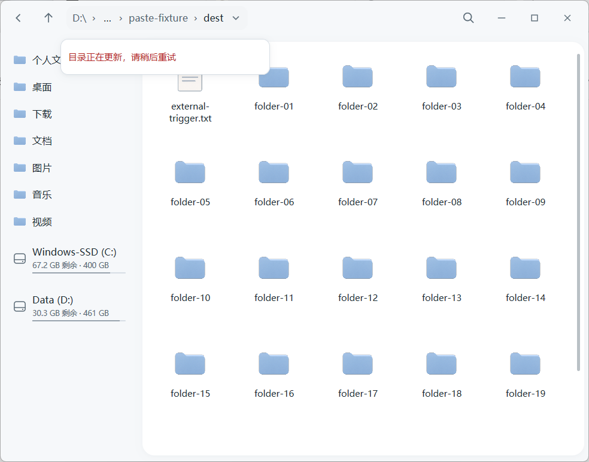
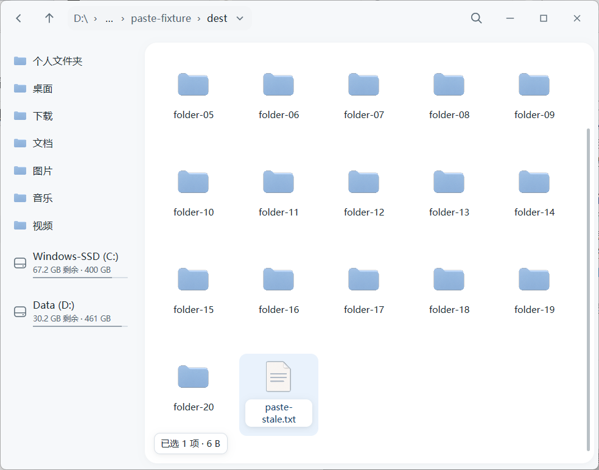
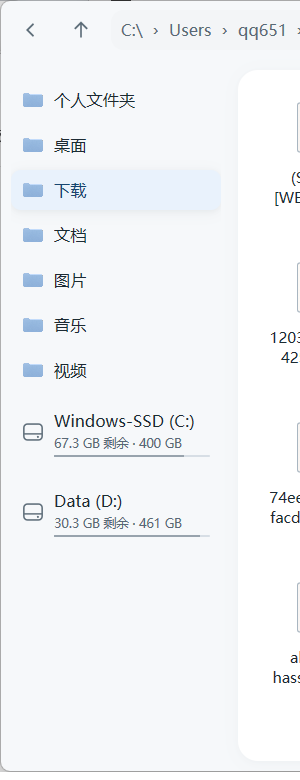
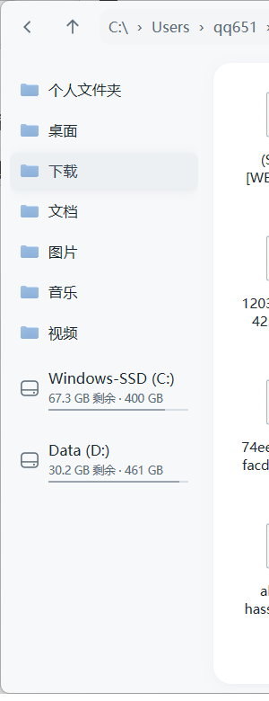

# preview.29 · 拖放/粘贴刷新、刷新期间 Ctrl+V 与侧栏当前项

日期：2026-11-06（Asia/Shanghai）
源码：`47af4ef`（三处修复）、`5ff6a3db8cbbda64bd4c28917188a896ea2d6f12`（preview.29 版本与说明）
候选版本：`0.1.0-preview.29`

## 修复内容

1. **操作完成后的列表刷新更及时**：应用内拖放、粘贴、删除、移动等操作触发的目录刷新不再等待 450ms 监听防抖，也不再要求窗口激活；任务处于进行中时只保留 pending，不会重新武装防抖计时器，任务完成后立即重建快照。对应“拖拽结束后一段时间才看到新文件”的等待路径。
2. **目录刷新期间 Ctrl+V 不再报错**：`file_command` 不再对 `Paste` 施加“目录正在更新，请稍后重试”拦截；粘贴只需要当前目录路径与捕获身份，目录快照尚未提交时也可以直接执行。若当前选中的是文件夹，则等视图稳定后再打开文件夹粘贴确认，避免对陈旧布局操作。
3. **左侧快捷访问当前项样式**：由文件区同款蓝色 `selection/surface` 改为低强调中性 `selection/inactive-surface` 与配对内容色，保持原几何尺寸和常规字重；不再与浅灰侧栏、白色文件表面以及蓝色文件选中互相争抢。

相关代码：`src/app_watch.rs`、`src/app_operations.rs`、`src/app_navigation.rs`；代码 diff 见 [fix.diff](fix.diff)，提交统计见 [fix-stat.txt](fix-stat.txt)。

## 刷新期间 Ctrl+V：修复前 / 修复后

同一操作序列：Backleaf 打开含 20 个目录的目标目录；从外部复制一个文件；在目标目录触发一次外部变更，等 watcher 进入刷新防抖窗口后，在 Backleaf 文件区按 Ctrl+V。

| preview.28（修复前） | preview.29（修复后） |
| --- | --- |
|  |  |
| 提示“目录正在更新，请稍后重试”，没有粘贴任何文件。 | 无错误提示，`paste-stale.txt` 出现在列表底部并带选中计数。 |

preview.28 复现 3/3 次失败并显示该提示；已发布 preview.29 的 3 次运行均成功，0 条错误提示。使用精简记录的已发布二进制数据：[修复前](paste-before-preview28-report.json)、[修复后（含早截图）](paste-after-preview29-report.json)、[修复后（无截图开销的时延）](paste-after-preview29-latency.json)。后者显示空闲粘贴 UI 可见约 432ms、刷新期间粘贴约 339ms（含操作本身与轮询间隔，并非性能基准）。

## 左侧当前项样式对比

同一窗口、同一选中项（下载）：

| preview.28（修复前） | preview.29（修复后） |
| --- | --- |
|  |  |
| 蓝色 `selection/surface` 整行底色，和文件区选中同色但与浅灰侧栏、白色文件区不协调。 | 低强调中性底与深灰文字，和侧栏及文件区更协调；几何尺寸与字重不变。 |

依据 `design/color-system.json` 的语义：文件选中是低强调蓝色表面；侧栏当前项属于导航位置而非文件选择，因此改用成对的中性 inactive-selection 角色，保留常规字重与同一行高。实际执行见 `src/app_navigation.rs`；截图来自已发布 preview.29 二进制。

## 已发布包

- Release：[test-v0.1.0-preview.29-5ff6a3db](https://github.com/simiooo/backleaf/releases/tag/test-v0.1.0-preview.29-5ff6a3db)，发布 2026-11-06 14:28:49 +08:00（06:28:49Z），pre-release，非 draft，tag 目标 `5ff6a3d`。
- [Windows 测试包 CI 42174117553](https://github.com/simiooo/backleaf/actions/runs/42174117553)（fmt/严格 Clippy/112 项逻辑-文件-原生测试/40 项无头交互/安装回归/打包）与 [headless CI 42174116531](https://github.com/simiooo/backleaf/actions/runs/42174116531) 均 success；原始结论见 [ci-package-status.json](ci-package-status.json)、[ci-headless-status.json](ci-headless-status.json)。
- 资产：ZIP `316578f9…e0917`（16,480,335 字节）、设计 `216c6ffd…5ab179`、构建记录 `d36f0204…439531`、摘要文件 `7847610f…5504c3`。
- ZIP、build.json、SHA256SUMS.txt 均经 HTTPS 匿名下载（无 GitHub token）；下载字节与 release 资产摘要一致。ZIP 内 `Backleaf.exe` 为 `00990232…d39838`，与 `build.json`（`source_commit=5ff6a3d`，`ci_run_url=.../42174117553`）一致；包内 `headless.json` 匹配 `headless_report_sha256=26491e39…8097`；`lib/7z.dll` 匹配 `78bf6b66…fabb82`。见 [public-assets.json](public-assets.json)、[public-build.json](public-build.json)、[public-SHA256SUMS.txt](public-SHA256SUMS.txt)、[ci-package-verified.json](ci-package-verified.json)。

## 匿名隔离安装

`scripts/native/test-installer-online.ps1` 匿名下载公开 release，校验资产/内部哈希与微软签名运行库清单，安装到隔离目录（`-NoShortcut`），检查 app-local 运行时加载与隐藏 CLI 诊断；未触碰默认用户安装。

- Windows PowerShell 5.1.26100.9711：`passed=true`，EXE `00990232…`，安装于 `.local/installer-staging/5-ed15cf3276b64f85b196b864a68b95d1`。[online-ps5.json](online-ps5.json)
- PowerShell 7.6.9（本机 portable）：`passed=true`，同一 EXE，安装于 `.local/installer-staging/7-f855894b24cf4d1a8ddc30ebd6959221`。[online-ps7.json](online-ps7.json)

## 已发布产物上的回归

- 删除占位：7 项删除后约 120ms 仍保留淡化占位而不是空白行（[截图](screenshots/blank-row-preview29.png)，[UIA 记录](blank-row-preview29-report.json)），preview.28 的修复未回退。
- 失败重试：12 项命名检查全部通过（锁定文件部分失败、释放后仅重试失败项、目标恰好两项、无重复、源完整、双实例干净退出）。[retry-visible-report.json](retry-visible-report.json)、[retry-visible.log](retry-visible.log)、[重试后](screenshots/04-after-retry.png)。

## 限制

- 真实 Explorer→Backleaf OLE 拖拽仍无法用自动注入鼠标稳定复现（与 preview.28 相同边界）；本次“拖拽后刷新”的修复通过粘贴/操作完成路径与代码复核验证，仍需产品用真实拖拽确认新文件出现时机。若仍感觉慢，请提供源/目标目录、文件大小和拖入后等待时长。
- 侧栏对比为浅色主题、单显示器 2560×1440；深色主题沿用同一语义角色的成对颜色，未单独截图。
- 安装验证为隔离目录，未替换用户默认安装；preview.29 仍为 trial candidate，未走产品验收。
- 本目录通过 `.gitattributes` 标记 `-text` 保留原始字节；[manifest.json](manifest.json) 记录除自身外每个文件的 SHA-256 与大小。
